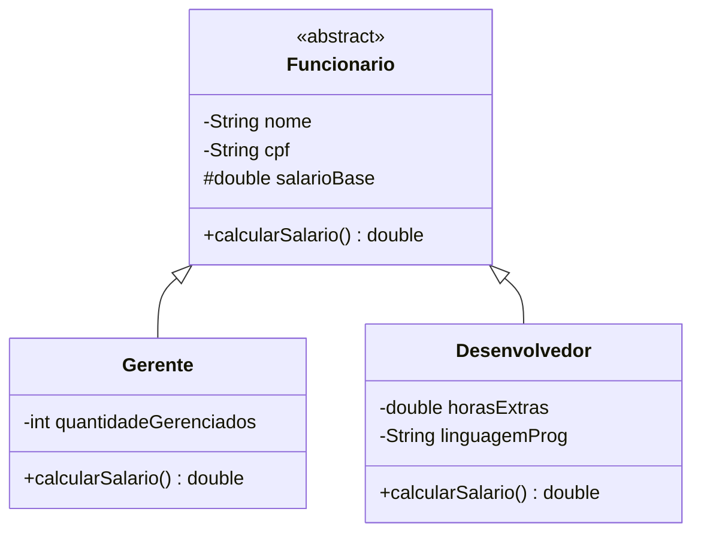

# Sistema-RH

# Folha de Pagamento

Aplicação de console em Java desenvolvida para praticar os pilares da Programação Orientada a Objetos, com foco em herança, classes abstratas e polimorfismo.

O sistema simula a rotina de um departamento de Recursos Humanos: cadastra funcionários de cargos distintos, calcula o salário de cada um conforme a regra do cargo e gera o total da folha de pagamento, com conversão para outras moedas.

**Status:** em desenvolvimento. As funcionalidades já implementadas e o planejamento das próximas etapas estão descritos abaixo.

---

## Funcionalidades

- Cadastro de funcionários (Gerente e Desenvolvedor) por meio de menu no console
- Listagem dos funcionários cadastrados
- Cálculo do total da folha de pagamento em reais
- Conversão do total para dólar, euro e yuan

## Regras de cálculo

| Cargo | Salário |
|---|---|
| Gerente | salário base + R$ 1.000 fixos + R$ 100 por subordinado |
| Desenvolvedor | salário base + (horas extras x R$ 50) |

Salários base negativos são tratados como R$ 0.

**Exemplo:**

| Funcionário | Dados | Salário calculado |
|---|---|---|
| Gerente | base de R$ 5.000 e 3 subordinados | R$ 6.300 |
| Desenvolvedor | base de R$ 4.000 e 10 horas extras | R$ 4.500 |
| **Total da folha** | | **R$ 10.800** |

## Conceitos aplicados

- **Herança:** `Gerente` e `Desenvolvedor` estendem `Funcionario`.
- **Classe abstrata:** `Funcionario` não pode ser instanciada e declara o método abstrato `calcularSalario()`.
- **Polimorfismo de sobreposição:** cada subclasse implementa `calcularSalario()` com a sua própria regra (`@Override`).
- **Polimorfismo de referência:** uma `List<Funcionario>` armazena qualquer tipo de funcionário, e o total da folha é calculado sem que o laço conheça o tipo concreto de cada objeto.
- **Encapsulamento:** atributos privados, getters e setters e validação do salário base.
- **Reaproveitamento com `super`:** uso de `super(...)` nos construtores e de `super.toString()` nas subclasses.

## Estrutura do projeto

```
.
├── Funcionario.java     # classe abstrata base
├── Gerente.java
├── Desenvolvedor.java
└── Main.java            # menu de console
```



## Execução

**Requisito:** JDK 15 ou superior (o código utiliza `String.formatted`).

```bash
git clone https://github.com/lucasemanoel00/NOME-DO-REPOSITORIO.git
cd NOME-DO-REPOSITORIO
javac *.java
java Main
```

Ao iniciar, o programa exibe o menu principal:

```
Digite [1] para cadastrar o funcionario
Digite [2] para ver a lista
Digite [3] para obter a folha de pagamento
Digite [0] para sair
```

## Cotações

As taxas de conversão são constantes fixas definidas na classe `Main`, com base em 09/10/2026. Têm finalidade apenas demonstrativa e não são atualizadas automaticamente.

| Moeda | Valor para cada R$ 1 |
|---|---|
| Dólar | 0,20 |
| Euro | 0,18 |
| Yuan | 1,34 |

## Próximos passos

- [ ] Criar a classe `Estagiario` (salário igual ao base, sem adicionais)
- [ ] Criar a interface `Bonificavel`, implementada por `Gerente` e `Desenvolvedor`
- [ ] Adicionar o método `exibirResumo()` à classe `Funcionario`
- [ ] Incluir no menu a listagem dos funcionários bonificáveis, utilizando `instanceof`
- [ ] Adicionar novos cargos, de outras áreas, para tornar o sistema mais completo

## Autor

Lucas Emanoel
[GitHub](https://github.com/lucasemanoel00) | [LinkedIn](https://www.linkedin.com/in/lucas-emanoel0/)
